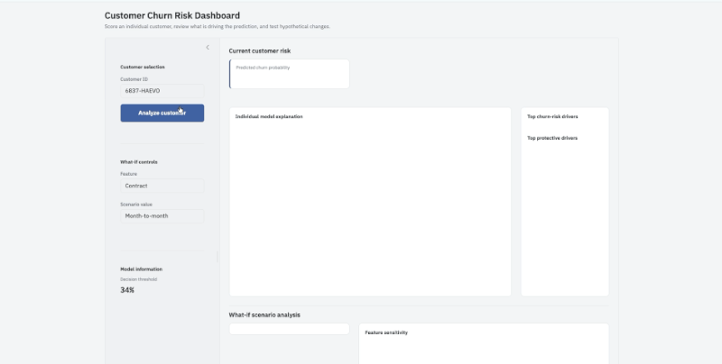

# Telco Customer Churn Prediction

Predicts which telecom customers are likely to churn, ranks them by risk, and explains each prediction. The project compares a statistically screened **logistic regression** with **XGBoost**, adds **SHAP** driver analysis and **Gemini**-written explanations, and includes a small **Shiny for Python** dashboard with what-if scenarios (local demo).

## Dataset
[Telco Customer Churn (Kaggle / IBM)](https://www.kaggle.com/datasets/blastchar/telco-customer-churn). The data file is not included in this repository. The notebook uses `WA_Fn-UseC_-Telco-Customer-Churn.csv` if it is in the folder and otherwise falls back to a public IBM mirror.

## Approach
1. Clean the data and split it 60 / 30 / 10 into train, test and validation sets.
2. Build features on the training set (no interaction terms).
3. Screen logistic regression (`statsmodels`) down to **13 predictors**: keep p < 0.05, drop predictors whose coefficient sign disagrees with the correlation with churn, then drop predictors with VIF > 3.
4. Train **XGBoost** on the same 13 features.
5. Evaluate with ROC-AUC and decile analysis; choose a decision threshold; confirm on the validation set.
6. Explain predictions with **SHAP** (global and per-customer drivers). **Gemini** only turns those SHAP results into plain-language text; it does not change the prediction.
7. Package the model and run a what-if dashboard in a Shiny app.

## Demo

Local demo of the Shiny for Python dashboard (run it with `shiny run app.py`): enter a customer ID to see the churn probability and the top drivers, then use the what-if sliders to see how the probability changes.




## Results
| Metric | Value |
| --- | --- |
| Logistic regression (13 predictors), validation ROC-AUC | 0.8566 |
| XGBoost, test ROC-AUC | 0.8460 |
| XGBoost, validation ROC-AUC | 0.8561 |
| Highest-risk decile (XGBoost, test set), observed churn rate | 73.1% (2.75x lift) |
| Share of churners captured in the top 30% of customers by risk | 67.6% |

## Repository contents
| File | Purpose |
| --- | --- |
| `Telco_Churn_Prediction.ipynb` | Full workflow, from data cleaning to deployment artifacts |
| `churn_scoring.py` | Reusable scoring and what-if logic (`ChurnScorer`) |
| `app.py` | Shiny for Python dashboard: customer ID, churn probability, top drivers, what-if sliders |
| `churn_model_bundle.pkl` | Trained model and metadata used by the scorer and the app |
| `demo_customer_data.csv` | Sample customers for the demo |
| `requirements.txt` | Python dependencies |
| `assets/` | Demo GIF and screenshots shown in this README |

## Run the dashboard locally
```bash
git clone https://github.com/Yasminehuo/telco-churn-prediction.git
cd telco-churn-prediction
python -m venv .venv
source .venv/bin/activate        # Windows: .venv\Scripts\activate
pip install -r requirements.txt
shiny run app.py --reload
```
Then open the local address that Shiny prints. The dashboard does not need an API key.

## Run the notebook
The notebook was developed in Google Colab. Run all cells top to bottom. Section 14 mounts Google Drive and reads a Gemini API key from `/content/drive/MyDrive/api_key.txt`; that key is needed for the Gemini explanation cells only, and the file must never be committed. Running all cells also regenerates `churn_scoring.py`, `app.py`, the model bundle and the demo data.

## Limitations
- One public dataset; no external validation and no production deployment (the dashboard is a local demo).
- The model bundle is a pickle: only load pickles from sources you trust.
- SHAP values describe contributions to the model's output, not causal effects or percentage-point changes in churn probability.

## License
MIT, see `LICENSE`.
