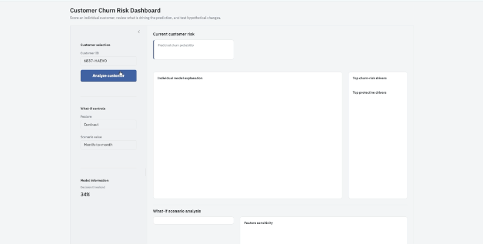

# Telco Customer Churn Prediction

[](https://colab.research.google.com/github/Yasminehuo/telco-churn-prediction/blob/main/Telco_Churn_Prediction.ipynb)

**Business problem.** A retention team can only contact a limited number of customers, so it needs to know who is most likely to cancel and why. This project ranks telecom customers by churn risk and explains each prediction in plain language.

**What it does.** It compares a statistically screened **logistic regression** with **XGBoost** on the same 13 features, adds **SHAP** driver analysis and **Gemini**-written explanations, and includes a small **Shiny for Python** dashboard with what-if scenarios (local demo).

**Headline result.** On the held-out test set, the highest-risk decile of customers (XGBoost) churned at **73.1%**, which is **2.75x** the average rate, and the top 30% of customers by risk contained **67.6%** of all churners.

## Dataset
[Telco Customer Churn (Kaggle / IBM)](https://www.kaggle.com/datasets/blastchar/telco-customer-churn): 7,043 customers, 26.5% churn. The data file is not included in this repository. The notebook uses `WA_Fn-UseC_-Telco-Customer-Churn.csv` if it is in the folder and otherwise falls back to a public IBM mirror.

## Key findings
In the logistic regression, churn is positively associated with being a new customer (tenure of 6 months or less), fiber optic internet service, and paying by electronic check. It is negatively associated with one-year and two-year contracts and with having no internet service. These are directions of association in this dataset, not causal effects.

## Approach
1. Clean the data and split it 60 / 30 / 10 into train, test and validation sets.
2. Build features on the training set (no interaction terms).
3. Screen logistic regression (`statsmodels`) down to **13 predictors**: keep p < 0.05, drop predictors whose coefficient sign disagrees with the correlation with churn, then drop predictors with VIF > 3.
4. Train **XGBoost** on the same 13 features (small grid search on ROC-AUC with 5-fold cross-validation).
5. Evaluate with ROC-AUC and decile analysis. For each model, choose the decision threshold that maximizes F1 on 5-fold out-of-fold training predictions (0.32 for logistic regression, 0.34 for XGBoost), evaluate on the test set, then confirm once on the untouched validation set.
6. Explain predictions with **SHAP** (global and per-customer drivers). **Gemini** only turns those SHAP results into plain-language text; it does not change the prediction.
7. Package the model and run a what-if dashboard in a Shiny app.

## Demo

Local demo of the Shiny for Python dashboard (run it with `shiny run app.py`): enter a customer ID to see the churn probability and the top drivers, then use the what-if sliders to see how the probability changes.




## Results
Both models use the same 13 features. Thresholds were fixed on the training data before the test and validation sets were scored.

| Model | Threshold | Test ROC-AUC | Validation ROC-AUC |
| --- | --- | --- | --- |
| Logistic regression (13 predictors) | 0.32 | 0.8438 | 0.8566 |
| XGBoost | 0.34 | 0.8460 | 0.8561 |

The two models discriminate about equally well. XGBoost was kept as the scoring model for the dashboard because it feeds the SHAP explanations.

| XGBoost, test set | Value |
| --- | --- |
| Observed churn rate in the highest-risk decile | 73.1% (2.75x lift) |
| Share of churners captured in the top 30% of customers by risk | 67.6% |

## Repository contents
| File | Purpose |
| --- | --- |
| `Telco_Churn_Prediction.ipynb` | Full workflow, from data cleaning to deployment artifacts |
| `churn_scoring.py` | Reusable scoring and what-if logic (`ChurnScorer`) |
| `app.py` | Shiny for Python dashboard: customer ID, churn probability, top drivers, what-if sliders |
| `churn_model_bundle.pkl` | Trained model and metadata used by the scorer and the app |
| `demo_customer_data.csv` | Sample customers for the demo |
| `requirements.txt` | Python dependencies (versions pinned to the ones used to build the model bundle) |
| `assets/` | Demo GIF and screenshots shown in this README |

## Run the dashboard locally
```bash
git clone https://github.com/Yasminehuo/telco-churn-prediction.git
cd telco-churn-prediction
python -m venv .venv
source .venv/bin/activate        # Windows: .venv\Scripts\activate
pip install -r requirements.txt
shiny run app.py --reload
```
Then open the local address that Shiny prints. The dashboard does not need an API key.

The pinned versions in `requirements.txt` are the ones used to build the model bundle in Google Colab with Python 3.13, so a recent Python (3.11 or newer) is recommended. Install the pinned versions rather than the latest ones: the model bundle is a pickle and may not load with a different XGBoost version.

## Run the notebook
The notebook was developed in Google Colab (use the badge above). Run all cells top to bottom. Section 14 mounts Google Drive and reads a Gemini API key from `/content/drive/MyDrive/api_key.txt`; that key is needed for the Gemini explanation cells only, and the file must never be committed. Running all cells also regenerates `churn_scoring.py`, `app.py`, the model bundle and the demo data.

## Limitations
- One public dataset; no external validation and no production deployment (the dashboard is a local demo).
- Decision thresholds were chosen to maximize F1, not to minimize business cost. A real retention program would also need to consider contact capacity, intervention cost and the cost of wrong predictions.
- The model bundle is a pickle: only load pickles from sources you trust.
- SHAP values describe contributions to the model's output, not causal effects or percentage-point changes in churn probability. The what-if sliders show how the model's prediction responds to changed inputs, not what would happen if a customer's circumstances actually changed.

## License
MIT, see `LICENSE`.
